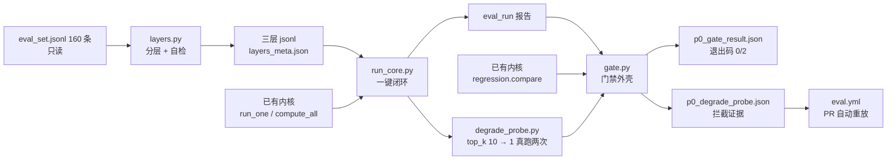
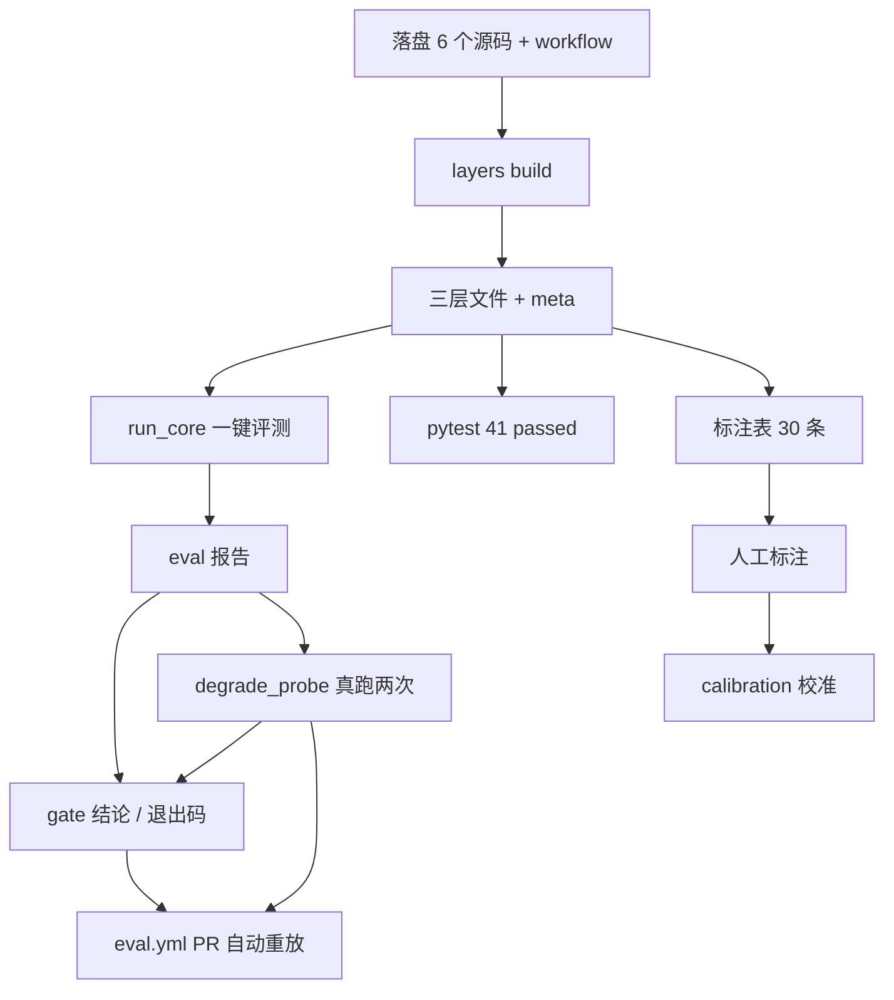
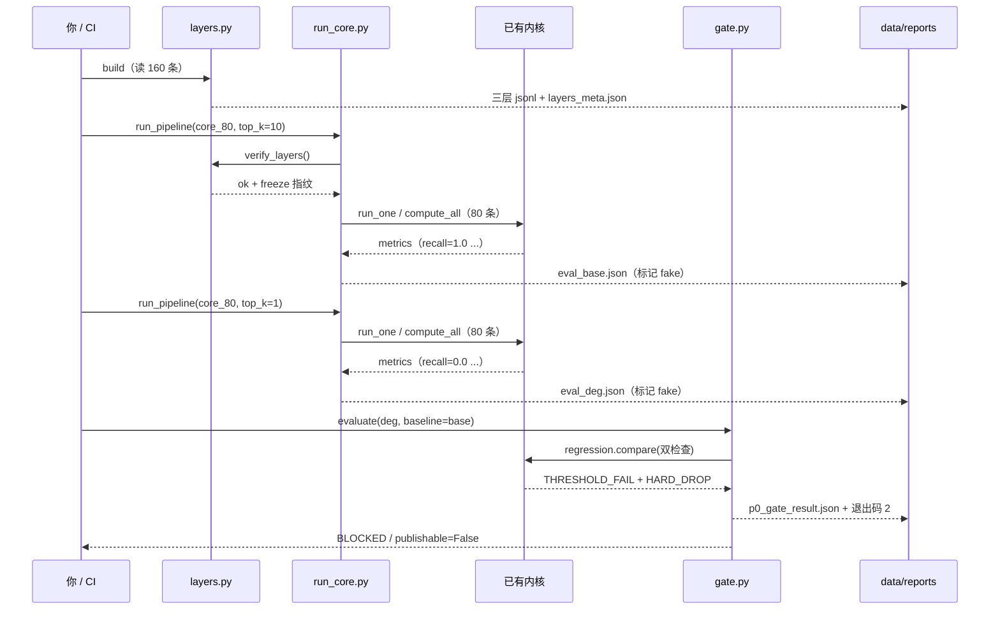

# P0 评测闭环落地 · 理解手册（大白话 + 图解）

> 这份只回答三件事：**这个阶段到底干了什么 / 改的文件之间怎么联动 / 整体流程是什么**。
> 不解释逐行代码（那是《说明手册》），也不写命令（那是《操作手册》）。
> 适合先读一遍建立整体认知，再照操作手册动手。

## 目录

- [一、一分钟版](#u1)
- [二、全景图](#u2)
- [三、文件清单](#u3)
- [四、代码怎么实现目标](#u4)
- [五、目录联动](#u5)
- [六、操作流程](#u6)
- [七、时序图](#u7)
- [八、Q&A](#u8)
- [九、面试话术](#u9)

---

## <a id="u1"></a>一、一分钟版

**三句话**：
1. 你的 MedEviRAG 里，「怎么算指标、怎么比两次结果」的内核早就写好了，但一直**没人调用、没接进 CI、也没人验证它会不会真的拦住变差的改动**。
2. P0 不重写内核，只补了一层「外壳」：把 160 条评测集分成 20/80/160 三层、一条命令跑完评测、把门禁接进 PR、再用一次真实的「把检索参数改坏」实验证明门禁会拦。
3. 最关键的不是功能，是**诚实**：离线桩跑出来的漂亮分数被打上「不可发布」标记，人评校准的数字绝不许 AI 代标。

打个比方：这阶段就是给一辆已经有发动机和仪表（评测内核）的车，**装上点火开关、把仪表接到驾驶位、再踩一脚刹车试试灵不灵**。发动机不用重造，但没这套东西，车只能停在车库里。

**一张最小全景图**

```
[160 条评测集] → 分三层 → [一键评测] → [指标报告] → [门禁]
                                                    ↓
                                        改坏参数 → 真的被拦住
```

---

## <a id="u2"></a>二、全景图

**ASCII（箭头方向 = 数据被谁拉取 / 谁写出）**

```
  只读区                          新增外壳                         产出区
┌──────────────┐          ┌────────────────────┐         ┌──────────────────┐
│ eval_set 160 │ ──拉取──> │ layers.py 分层/自检 │ ─写出─> │ 三层 jsonl + meta│
│ freeze.json  │          └────────────────────┘         └────────┬─────────┘
└──────────────┘                                                   │ 拉取
                                                                    v
┌──────────────┐          ┌────────────────────┐         ┌──────────────────┐
│ runner.run_one│ <─复用── │ run_core.py 一键闭环│ ─写出─> │ eval_<id>.json   │
│ metrics/judges│          └────────────────────┘         │ + .md + scores   │
│ regression    │                                         └────────┬─────────┘
└──────┬───────┘                                                   │ 拉取
       │ 复用                                                      v
       └──────────────────> ┌──────────────┐  ─写出─>  ┌──────────────────┐
                            │ gate.py 门禁 │           │ p0_gate_result   │
                            └──────────────┘           │ p0_degrade_probe  │
                                   ↑                   └──────────────────┘
                                   │ 跑两次对比
                            degrade_probe.py
                                   │
                                   v
                          .github/workflows/eval.yml（PR 时自动重放上面整条链）
```

**Mermaid**



> **一句话记住**：所有箭头都指向「报告与结论」，P0 只是把已有内核的输出**接到了能被 CI 和面试验证的地方**。

---

## <a id="u3"></a>三、文件清单

| 文件 | 一句话作用 | 新建/已有 |
|---|---|---|
| `src/medevirag/eval/layers.py` | 把 160 条分成三层并验字段、算指纹 | 🟢 新建 |
| `src/medevirag/eval/calibration.py` | 算人评与 judge 的一致性，并拒绝假数据 | 🟢 新建 |
| `src/medevirag/eval/gate.py` | 在已有门禁外补噪声带、防桩、run 作废 | 🟢 新建 |
| `scripts/eval/run_core.py` | 一条命令跑完校验→评测→报告→门禁 | 🟢 新建 |
| `scripts/eval/make_label_sheet.py` | 生成 30 条空白人工标注表 + 档位说明 | 🟢 新建 |
| `scripts/eval/degrade_probe.py` | 真跑两次，证明改坏参数会被拦 | 🟢 新建 |
| `.github/workflows/eval.yml` | PR 时自动跑上面整条链 | 🟢 新建 |
| `tests/eval/test_p0_*.py` | 16 个用例，用 importorskip 保护存量基线 | 🟢 新建（AI 已写入项目） |
| `src/medevirag/eval/{runner,regression,metrics,judges}.py` | 已有计算内核，**一行没改，只读复用** | ⚪ 已有 |
| `configs/eval.yaml` | 阈值与噪声带配置，**一行没改** | ⚪ 已有 |
| `data/eval/layers/*` | 运行时产出的三层数据与指纹 | 🟣 运行时 |
| `data/reports/*` | 报告、门禁结论、劣化证据 | 🟣 运行时 |

**涉及 4 个顶层目录**：`src/medevirag/eval/`、`scripts/eval/`、`.github/workflows/`、`tests/eval/` —— 这也是本阶段必须出理解手册的原因（≥3 个目录 + 新增文件 ≥10 个）。

---

## <a id="u4"></a>四、代码怎么实现目标（从「声明」到「见效」）

| 步 | 这步做了什么 | 不做的后果 |
|---|---|---|
| 1 | `layers.py` 声明三层结构、字段规则、指纹算法 | 门禁只有一档成本，跑一次全量太贵，PR 里根本跑不起 |
| 2 | `layers build` 真正写出三层文件与 `layers_meta.json` | 后面所有脚本读不到分层文件，一步都走不下去 |
| 3 | `run_core.py` 把 `verify_layers → run_one → compute_all → gate.evaluate` 串起来 | 内核再好也只是几个能单独 import 的函数，没人用 |
| 4 | `gate.py` 产出机器可读的 `p0_gate_result.json` 与退出码 0/2 | CI 无法判断该不该拦，门禁变成「打印一行字」 |
| 5 | `degrade_probe.py` 用「正常 / 改坏」两份真报告喂给门禁 | 你只能说「我写了门禁」，说不出「它真的拦住过」 |
| 6 | `eval.yml` 把 2–5 注册成 PR 触发的 job | 全靠人记得手动跑，三周后必然荒废 |
| 7 | `calibration.py` + 标注表把「judge 可不可信」变成可执行的流程 | 简历里 `Spearman ρ 0.7X` 永远是个空 |

**关键点**：第 2 步是**产出**，第 3–6 步都是**消费**。顺序反了就会出现「文件不存在」「基线读不到」这类看起来像代码错、其实是执行顺序错的问题（历史项目里踩过 Docker bind-mount 同类坑）。

---

## <a id="u5"></a>五、目录联动（各目录怎么连线）

| # | 连线 | 靠什么耦合 |
|---|---|---|
| 1 | `data/eval/` ↔ `src/medevirag/eval/layers.py` | 固定相对路径 `data/eval/eval_set.jsonl` / `freeze.json` / `layers/` |
| 2 | `layers.py` ↔ `scripts/eval/run_core.py` | `verify_layers()` 的返回值 + `LAYER_DIR` 常量 + `layers_meta.json` 的 `freeze_set_sha256` |
| 3 | `scripts/eval/run_core.py` ↔ `src/medevirag/eval/{runner,metrics}` | 直接调用公开函数 `run_one` / `compute_all` / `make_run_id`，签名逐一对过 |
| 4 | `run_core.py` ↔ `gate.py` | 报告 JSON 的结构 `{"metrics": ..., "cases": ...}`，与 `regression.load_run` 的期望完全一致 |
| 5 | `gate.py` ↔ `configs/eval.yaml` | `cfg.eval.thresholds.*`、`cfg.eval.regression.max_drop/hard_drop`，**只读不改** |
| 6 | `degrade_probe.py` ↔ `run_core.py` | 同目录 `from run_core import run_pipeline`（靠文件路径运行时的 `sys.path[0]`） |
| 7 | `tests/eval/` ↔ 三个新模块 | `pytest.importorskip("medevirag.eval.xxx")`；模块不在就整文件 SKIP |
| 8 | `.github/workflows/` ↔ 全部 | `PYTHONPATH=src` 环境变量 + 4 条命令；`paths` glob 决定何时触发 |
| 9 | `data/reports/` ↔ 面试材料 | 报告与证据文件是唯一能自证数字的地方，截图/数字都从这里取 |

> **一句话记住**：目录之间没有隐藏的全局变量，全部靠「文件路径 + 函数签名 + 一个 JSON 结构」三样东西明着连起来。

---

## <a id="u6"></a>六、操作流程

| 序 | 操作 | 致命注意点 |
|---|---|---|
| 1 | 核基线 `pytest tests/eval -q` | 此时应看到 `25 passed, 3 skipped`；看到 `41 passed` 说明之前落过盘 |
| 2 | 依次新建 6 个源码文件 | 只贴代码块内容，**别把围栏和说明行贴进文件** |
| 3 | 新建 `eval.yml` | `on.pull_request.paths` 五条 glob 一条不能少 |
| 4 | `layers build / verify / stats` | 第一行 WARN 是发现，不是报错；**不要去改 freeze.json** |
| 5 | `pytest tests/eval -q` → 41 passed | 解释器必须是 `.venv\Scripts\python.exe` 全路径 |
| 6 | `run_core.py --layer core_80` | `publishable=False` 是正常的，别当成失败 |
| 7 | `degrade_probe.py` | `EXIT=0` 表示实验成功拦住；门禁自己的退出码是 2 |
| 8 | `make_label_sheet.py` → 人工标 30 条 | **AI 不能代标**，另存为 `human_labels_30.jsonl` |
| 9 | `gate` CLI / A–H 自检 | PowerShell 用 `$LASTEXITCODE`，不是 `$?` |

**依赖顺序图（ASCII）**

```
落盘源码(§7-§13)
      │
      v
layers build ──> 三层文件 + meta ──┬──> run_core ──> 报告 ──┬──> gate CLI
                                  │                        │
                                  ├──> pytest               └──> degrade_probe
                                  └──> make_label_sheet ──> 人工标注 ──> calibration
                                                                    │
                                                                    v
                                                              eval.yml（PR 重放）
```

**Mermaid**



> **一句话记住**：所有箭头都从 `layers build` 出发——它没跑，后面全是空文件报错。

---

## <a id="u7"></a>七、时序图：一次「劣化注入」的完整旅程

**Mermaid**



**ASCII**

```
你        layers      run_core     内核      gate       reports
│           │            │          │          │           │
│─ build ──>│            │          │          │           │
│           │── 写三层 + meta ─────────────────────────────>│
│─ 正常跑 ──────────────>│          │          │           │
│           │<─ verify ──│          │          │           │
│           │            │─ run_one ─>│        │           │
│           │            │<─ 指标 ────│        │           │
│           │            │── eval_base.json ──────────────>│
│─ 改坏跑 ──────────────>│          │          │           │
│           │            │─ run_one ─>│        │           │
│           │            │── eval_deg.json ───────────────>│
│─ evaluate(deg, base) ────────────────────────>│          │
│           │            │          │<─ compare│          │
│           │            │          │──────────>│          │
│<──────────────── BLOCKED / exit 2 ───────────│          │
```

> **一句话记住**：两次真跑，只差一个 `top_k`，门禁从「放行」翻成「拦截」——这条因果链就是 P0 的核心证据。

---

## <a id="u8"></a>八、Q&A（最容易卡住的 8 个问题）

**Q1：为什么这阶段叫「闭环」？**
因为原来只有「算指标」和「比两次结果」两个孤立函数，没有入口、没有 CI、没有证据。闭环 = 改动一发生，评测自动跑、门禁自动判、结论自动落盘。

**Q2：`[WARN] SPLIT_DISTRIBUTION_MISMATCH` 是不是我数据坏了？**
是存量数据本来就有的不一致（冻结文件说有 32 条 test，实际一条没有）。P0 不修原文件，改为绕开 `split` 字段自己分层，并把不一致显式打出来。**这是发现，不是故障**。

**Q3：`Recall@10 = 1.0` 能不能写进简历？**
不能。它来自确定性桩（直接把标准答案塞进检索结果），只证明管线通。报告里 `publishable=False` 就是这道闸门。能写的是「劣化注入后门禁以退出码 2 拦截」这类**管线结论**。

**Q4：为什么门禁报 `PASS` 却又说 `publishable=False`？**
两个维度：`status` 回答「这次改动有没有让指标变差」，`publishable` 回答「这个数字能不能对外说」。CI 跑桩验证管线是正常做法，不该被判失败；但也不能假装它是质量结果。

**Q5：为什么 `degrade_probe.py` 返回 0 而 `gate` 返回 2？**
脚本的 0 是「实验按预期完成（拦住了）」；门禁的 2 是「这次改动被拦下」。如果哪天 probe 返回 1，说明门禁**没**拦住，才是真出事。

**Q6：三层为什么要嵌套，不能各抽各的？**
不嵌套的话，冒烟过了核心挂了，你分不清是「新样本带来的问题」还是「同一批样本质量变了」。嵌套让排查可以逐层放大。

**Q7：为什么人评 30 条不让我用 AI 生成？**
用模型生成答案、再让同类模型打分，等于自己评自己，相关系数虚高。面试官问「谁标的、分歧怎么仲裁」立刻穿。P0 只把脚本和标注表备好，数字等你标完再出。

**Q8：这个跟「测评中台 / 数据中台」有什么关系？**
都不是。P0 是**一个项目内部的评测基建**。它体现了「统一标准 + 复用 + 服务化」的中台思维（两个项目将来可共用一套评测协议），但个人项目不该叫中台——那需要多个团队真实复用才成立。岗位上它对应 JD 里的「评测能力约 15%」，数据中台则是另一条赛道。

---

## <a id="u9"></a>九、面试话术

### 30 秒版本

> 「我的 MedEviRAG 里评测内核早就有了，但它没入口、没接 CI，也没人验证过它会不会真的拦住质量下降。P0 我做了三件事：把 160 条评测集分成 20/80/160 三层并加冻结指纹；写一条命令把评测、报告、门禁串起来并接进 PR；然后做了一次劣化注入——把检索 top_k 从 10 改成 1，四个检索指标从 1.0 掉到 0.0，门禁以退出码 2 拦下并给出 6 条归因。更重要的是我发现原来的 judge 跑的是离线桩，分数永远是满分，所以我给报告加了 `publishable=False`，把发布资格和门禁结果拆开，不允许把自测数字当成质量结论。」

### 追问应对（每个数字都有出处）

| 追问 | 回答 | 出处 |
|---|---|---|
| 三层各多少、怎么分的？ | 20 / 80 / 160，按题型配额 + `sha256(salt:case_id)` 确定性排序，逐层嵌套；core 是 45 可答 / 10 多跳 / 25 应拒 | `layers build` 实跑原文 |
| 怎么防评测集被偷偷改？ | 源集 + 三层文件整文件 sha256，`verify` 重算；改一个字就 FAIL，单测里故意追加一行验证过 | `test_p0_layers.py` |
| 门禁只拦「很差」吗？ | 三层防线：绝对阈值、`hard_drop=0.05` 硬跌、以及我补的 `max_drop=0.02~0.05` 噪声带记录 | `gate.py` + `configs/eval.yaml` |
| 你说拦住了，证据呢？ | `p0_degrade_probe.json`：baseline/degraded 两个真 run_id、四组指标前后值、6 条 GATE 问题、`gate_status=BLOCKED` | `degrade_probe.py` 实跑 |
| judge 校准做了吗？ | 流程打通了（Spearman ρ + Cohen κ + 严重分歧率），但 30 条人评和真实 judge 分数还没产出，**所以我简历里没写 ρ 值**；脚本会主动拒绝 AI 代标和离线桩分数 | `calibration.py` |
| 为什么不改 `runner.py` 里硬编码的 fake？ | 那是存量代码，我在外层用组合方式标记，既不动原文件、也不破坏后续阶段 diff；「组合优于改写」 | `gate.py` 的 `publishable` |
| 测试怎么保证不破坏原有项目？ | 新测试用 `pytest.importorskip`，源码未落盘时 `25 passed, 3 skipped`，落盘后 `41 passed`，基线一次没红 | 真实项目实跑 |

### 🔴 三个绝对不能说的数字

1. `Recall@10 = 1.0` —— 确定性桩自测值。
2. `faithfulness = 1.0` —— 离线桩 judge 全返回 `ok=True`。
3. `Spearman ρ = 0.7X` —— 还没有人评数据。

> **收尾金句**：「评测体系最容易骗人的地方不是算错指标，是**用一个看起来正常的数字掩盖了它根本不可信**。我这阶段做的就是把这类地方逐个找出来、打上标记、再用可复现的实验证明门禁真的有效。」
